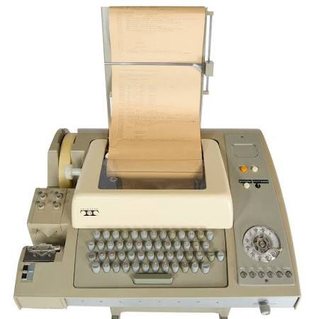

# DND#1 — text-terminal BASIC restoration

A preservation and playable recreation of **Richard Garriott's _Dungeons and Dragons #1_ (1977)**, aimed primarily at the **TRS-80 Model III** while keeping the BASIC source as portable as practical. The emphasis is on the original **Teletype-era experience**: printed words, numeric dungeon maps, numbered commands, random encounters, treasure, and a decidedly unforgiving dungeon.

**Status (22 November 2026):** a **new, self-contained, playable BASIC adaptation** has been developed and tested under **trs80gp 2.5.8 emulating a TRS-80 Model III running ROM BASIC**. This is **not a line-for-line repair** of the complete historical program; some gameplay mechanics have been simplified or reconstructed, and the original files are preserved unchanged. **LDOS LBASIC 5.1 and physical Model III testing are still to do.**

## PDP-11 / RSTS/E BASIC-PLUS edition — experimental

We are now also building a **PDP-11** edition intended for **RSTS/E BASIC-PLUS**, inspired by Roy's memories of a **Teletype Model 33** on a school time-sharing system. The **exact 1977 host machine remains unknown**; targeting a PDP-11 now does not establish that the historical game originally ran on one.

**[View `pdp11/DND11.BAS`](pdp11/DND11.BAS)** — the first self-contained **BASIC-PLUS V7.1-style source port** (602 numbered lines), based on the playable Model III restoration. It includes the same **seven dungeon maps**, classes, equipment shop, typed commands and paper-tape-style save/restore, with extensive explanatory `REM` statements.

The PDP-11 version is adjusted for DEC's syntax: `EXTEND` mode, backslash (`\`) between statements, string functions **`MID(...)`** and **`LEFT(...)`** (not the Model III `MID$` / `LEFT$`), no `CLEAR 3000`, and short **26-character map `DATA` rows** better suited to a printed terminal listing. Rebuild it with `python3 tools/build_pdp11.py` and check it with `python3 tests/check_pdp11.py`.

**Testing status:** this edition has **passed static checks only**. It has **not yet been entered, translated or run under a PDP-11/RSTS/E BASIC-PLUS interpreter**. The **TRS-80 Model III ROM BASIC edition remains the emulator-tested playable reference**. See the [PDP-11 installation and test guide](docs/PDP11_BASICPLUS.md) for the proposed `NEW`, `SAVE`, `RUN` workflow and compatibility caveats.

**Language reference provided for development:** Digital Equipment Corporation, *BASIC-PLUS Language Manual*, **AA-2623D-TC**, December 1981 (**RSTS/E V7.1 / BASIC-PLUS V7.1**). The manual documents `EXTEND` / `NOEXTEND` (chapter 7), `REM` (7.4), control/input/data syntax (chapter 9), and `LEFT`/`MID` (10.5). The uploaded manual itself is not redistributed in this repository.

## What did the original DND#1 run on?

**New source-based identification (22 November 2026):** the historical listing is a very close match for **Control Data Corporation (CDC) BASIC**, specifically the syntax documented for **CDC BASIC Version 2.0/2.1** on **CDC CYBER / 6000-series time-sharing computers**. This is stronger evidence than the often-repeated PDP-11 attribution.

Its original `BASE 0`, `FILE #1="DNG1"`, `READ #D,...`, `WRITE #7,...`, `RESTORE #4` and particularly `RND(CLK(J9))` are all documented in the [1974 CDC BASIC Version 2 reference manual](https://bitsavers.trailing-edge.com/pdf/cdc/cyber/lang/basic/19980300B_BASIC_Language_Version_2_Reference_Nov74.pdf). The manual even demonstrates seeding a random sequence via `RND(CLK(0))`.

The exact CDC **model, OS and BASIC compiler revision are not established** by the surviving source. [Garriott's 2014 account](https://www.shroudoftheavatar.com/?p=39149) refers to a PDP-11-type computer, while [later CRPG historical research](https://crpgaddict.blogspot.com/2021/07/game-421-dungeons-and-dragons-1-1977.html) identifies a CDC-6000. Our **PDP-11 BASIC-PLUS edition is deliberately a modern alternative port**, not a claim that the original was written in DEC BASIC.

**[Read the full evidence-based original-platform investigation](docs/ORIGINAL_PLATFORM.md).**

## CDC BASIC Version 2 — historical-source restoration

The repository now includes a **full repaired copy of the historical 1,215-line program**, expanded to **1,233 numbered lines** while preserving its original line numbers and game systems. This **CDC BASIC Version 2-compatible first pass** is intended for the **CYBER 70, CYBER 170 and 6000-series** computer families, using the original external numbered-file workflow.

- **[cdc/DND1CDC.BAS](cdc/DND1CDC.BAS)** — complete source-derived DND#1 game (character creation, original equipment, all six historical dungeons, monsters, combat, magic and `GMSTR` save/load), with documented repairs
- **[cdc/MAKEFILE.BAS](cdc/MAKEFILE.BAS)** — important **initialiser**: builds six native CDC binary dungeon files plus a fresh `GMSTR` from the original 26×26 map data. **Warning: it overwrites those existing files**
- **[cdc/data/](cdc/data/)** — inspectable copies of all six historical grids; archival `DND3` is named `DNG3` **in the CDC folder only** so it matches Garriott's source
- **[CDC time-sharing environment and installation](docs/CDC_BASIC_ENVIRONMENT.md)** — explains SCOPE/INTERCOM versus KRONOS/NOS, remote terminals, the `READY.` prompt and first-use procedures
- **[Source repair log](docs/CDC_REPAIRS.md)** and **[automated static checks](tests/check_cdc.py)** — what changed and what remains untested

**Status:** all 1,233 main statements and the initializer have passed the conservative **72-character line limit**, branch-target and dungeon-data consistency checks. **This source has NOT yet been compiled or run on a real/emulated CDC BASIC 2.0/2.1 system**, so actual runtime playability and save compatibility remain to be verified. The **TRS-80 Model III edition remains our emulator-tested game**.

### Historical hardware: a CDC 6000-series computer and a Model 33 Teletype


*CDC 6600 mainframe, photographed by [Jitze Couperus](https://commons.wikimedia.org/wiki/File:CDC_6600.jc.jpg), [CC BY 2.0](https://creativecommons.org/licenses/by/2.0/). This is an example of a CDC 6000-series computer, **not evidence of the exact DND#1 host**. See also [CDC 6000 series — Wikipedia](https://en.wikipedia.org/wiki/CDC_6000_series).*



*Teletype ASR 33 printing terminal with paper-tape reader. **Image supplied by the project maintainer** for this restoration; original photographer and licence not documented. This illustrates the period's remote terminal experience; **it is not identified as the specific terminal used by Richard Garriott**.*

### How we identified the original BASIC and computer — research history

The platform identification was a multi-step investigation, not an assumption based on which computer Garriott remembered:

1. **Starting with Garriott's surviving source:** the repository's [`DND.BAS`](DND.BAS), historical scan and the [independent Gist transcription](https://gist.github.com/bussiere/11137495) revealed distinctive syntax: `BASE 0`, `FILE #1="DNG1"`, `READ #D`, `WRITE #7`, `RESTORE #4` and `RND(CLK(J9))`. These are much more diagnostic than common `PRINT` or `GOTO` statements.
2. **Checking the PDP-11 theory:** [Garriott's 2014 account](https://www.shroudoftheavatar.com/?p=39149) recalls a “PDP 11 type” machine reached by acoustic modem from a teletype. We also examined the **December 1981 DEC RSTS/E BASIC-PLUS Language Manual** supplied for this project. Its file programming model does not explain the original `FILE #` numbered-file statements, so our [PDP-11 BASIC-PLUS edition](pdp11/DND11.BAS) is a **port**, not a claim about the original compiler.
3. **Finding the Control Data documentation:** the [CDC *BASIC Language Version 2 Reference Manual*, October 1974](https://bitsavers.trailing-edge.com/pdf/cdc/cyber/lang/basic/19980300B_BASIC_Language_Version_2_Reference_Nov74.pdf), covers CYBER 70/170 and CDC 6000 systems. It explicitly documents **every one** of those unusual source constructs. It even uses **`RND(CLK(0))`** as an example of seeding the random-number generator. That combination is extremely strong **language-family evidence**.
4. **Checking actual 1970s time-sharing procedures:** the same manual has terminal examples for **KRONOS/NOS** (`RECOVER /SYSTEM:BASIC`, `OLD, NEW, OR LIB FILE`, `READY.`) and for **SCOPE/INTERCOM**. It explicitly discusses **Model 33 and Model 35 TTY** remote terminals. It does **not** prove which OS or terminal model was used for this particular game.
5. **Cross-checking independent historical accounts:** [the CRPG Addict's 2021 investigation](https://crpgaddict.blogspot.com/2021/07/game-421-dungeons-and-dragons-1-1977.html) also associates the game with a CDC-6000 rather than the commonly repeated PDP-11 attribution. The [1979 surviving printout](https://gist.github.com/bussiere/11137495) supplies a later archival date, not an exact original compiler version.

**Research conclusion:** **CDC BASIC Version 2.0/2.1-compatible syntax — high confidence. CDC CYBER/6000 family — strongly indicated. Exact model, OS and compiler release — unverified.** Our [full source-evidence report](docs/ORIGINAL_PLATFORM.md) preserves those distinctions. This explains why we are developing separate CDC, PDP-11 and TRS-80 editions rather than conflating them.

## Use the real TRS-80 Model III as a PiDP-11/70 terminal

**[TTY300.BAS — LDOS/LBASIC 300-baud terminal](basic/TTY300.BAS)** is a new, **pure BASIC** serial-terminal experiment for Roy's **48 KB Model III with RS-232**, communicating with a **PiDP-11/70 running RSTS/E** via a Raspberry Pi **USB-to-RS-232 adapter**. It emulates a simple printing terminal, inspired by the **Teletype ASR 33** pictured below; the game runs **on RSTS/E**, and the Model III provides the keyboard and display.

It uses the Model III UART ports directly (**232–235**), with **300 baud, 8N1, no flow control**, keyboard transmit, received-character display, CR/LF handling and basic backspace. It does **not** require the LDOS `*CL` driver; **do not run it while `RS232T/DVR` is managing the same port**.

**[Wiring, installation and PiDP-11/SIMH serial setup](docs/TTY300_SETUP.md)** explains the DB25-to-USB-DB9 **null-modem connection**, `/dev/ttyUSB0`, the RSTS/E terminal-line requirement, and how to start the experimental [PDP-11 BASIC-PLUS DND port](pdp11/DND11.BAS). The *CDC BASIC source is not directly compatible with RSTS/E*.

**Testing:** a basic emulator startup and static source checks pass; actual RS-232 communication with the PiDP-11/70 **has not yet been tested**. A BASIC polling terminal can drop incoming characters even at 300 baud—see the contemporary [LDOS Quarterly](https://www.tim-mann.org/trs80/doc/ldosq1-6.pdf). For reliable lengthy output, the supplied **LDOS LCOMM/CMD** with the interrupt-buffered **RS232T/DVR** is the recommended fallback.

## Play the restored BASIC game

**[Download / view DND1PLAY.BAS](DND1PLAY.BAS)** — 8-character DOS-friendly basename, plain-text numbered BASIC, with extensive `REM` explanations and **all seven surviving dungeon maps embedded**. No external dungeon files, special graphics, `PEEK`, `POKE` or host-dependent disk commands are needed during play.

With [George Phillips' trs80gp emulator](https://48k.ca/trs80gp.html), a convenient test is:

```sh
trs80gp -m3 DND1PLAY.BAS
```

Or start trs80gp in Model III mode and choose **File → Run** with `DND1PLAY.BAS`. This method directly runs the listing in **Model III ROM BASIC**; it is **not proof of LDOS LBASIC compatibility**. To run on a physical Model III, the plain-text listing must first be transferred/imported as a BASIC program, using a compatible method and adequate string memory. It has not yet been tested on real hardware.

Answer **N** for a new game, choose a dungeon (1–6 from the surviving external grids; **7** is the distinct map embedded in Roy's earlier port), enter any player name, pick **Fighter, Cleric or Wizard**, and purchase equipment. Type **99** for help. A seed of **0** selects the repeatable default seed `1977`.

| Command | Action |
| --- | --- |
| `1` | Move one square: U, D, L, R |
| `2` | Open an adjacent door |
| `3` | Search for traps and secret doors |
| `4` | Change weapons |
| `5` | Fight an encountered monster |
| `6` | Look around (numeric 11×11 dungeon view, `9` = player) |
| `7` | Print a **paper-tape-style save record** |
| `8` | Cast magic (healing, attack, reveal) |
| `9` | Buy a magic point |
| `0` | Pass a turn |
| `10` | View statistics and inventory |
| `11` | Buy a hit point |
| `12` | Eat spare food |
| `98` / `99` | Quit / display help |

A saved game prints the hero's information and 26 rows of 26 digits. On a later run, choose **O** for **Old Tape**, then enter those recorded values and rows. This uses standard `PRINT`/`INPUT` instead of device-specific file I/O; **it does not automatically create a disk save file**. Save and restore have been exercised in the emulator.

See [the play guide](docs/PLAY_GUIDE.md) for instructions and caveats.

## Historical source material — preserved

| File | Description |
| --- | --- |
| [DND.BAS](DND.BAS) | Historical-version BASIC transcription; retains its original file I/O dialect and quirks |
| [DND1TRS.BAS](DND1TRS.BAS) | Roy's unfinished 2021 TRS-80/LDOS LBASIC conversion, preserved **as received** |
| [DND1_source.pdf](DND1_source.pdf) | Surviving scanned historical source listing |
| `DNG1`, `DNG2`, `DND3`, `DNG4`, `DNG5`, `DNG6` | Six complete 26×26 original-format numeric dungeon files |
| [GMSTR](GMSTR) | Surviving game-state/map data (historical reference; not used by the new game at runtime) |
| [DND1PLAY.BAS](DND1PLAY.BAS) | **New playable TRS-80/portable BASIC reconstruction**; original files not overwritten |
| [pdp11/DND11.BAS](pdp11/DND11.BAS) | **New experimental PDP-11 / RSTS/E BASIC-PLUS source**; currently statically verified, not runtime tested |
| [tests/check_playable.py](tests/check_playable.py) | Reproducible check of BASIC line references and all seven embedded map datasets |

The historical transcription expects `DNG3`, but the preserved third dungeon file is named `DND3`. The newer game embeds its data and doesn't depend on that filename at runtime. The seventh map comes from the separate 26×26 `DATA` block in `DND1TRS.BAS`; it is **not identical** to any of the six external maps.

The port avoids `RESTORE <line>` (not supported by Model III ROM BASIC) and encodes each dungeon as **five quoted `DATA` strings**, each at most 156 digits. That makes all seven maps fit in the single listing while reducing loading overhead. `CLEAR 3000` reserves BASIC string storage in Model III BASIC; other dialects may need that one startup statement adjusted.

## Documentation and test results

- [PDP-11 / RSTS/E BASIC-PLUS port and test plan](docs/PDP11_BASICPLUS.md) — DEC dialect differences, manual reference and proposed runtime tests.
- [Restoration design and changes](docs/RESTORATION_2026.md) — what was rebuilt, what is faithful, and what differs.
- [Playing and saving](docs/PLAY_GUIDE.md) — concise user guide.
- [TRS80gp testing notes](docs/TRS80GP_TESTING.md) — emulator test protocol plus dated results.
- [Initial archival source audit](docs/SOURCE_AUDIT.md) — original-source and external-data findings.

**Verified in emulator:** starting Fighter and Wizard characters, equipment shop, loading Dungeons 1, 2 and 7, look/help, moving and searching, status, monster encounter, offensive spell, retaliation/game-over, printing a full save, restoring a saved hero and map, and exit to BASIC. The static checker also validates all seven embedded grids against the surviving originals. **Not yet verified:** every historical rule/edge case, all dungeon playthroughs, LDOS LBASIC 5.1, physical hardware, **PDP-11 / RSTS/E BASIC-PLUS runtime**, or a fully authentic recreation of the incomplete original.

## Period references and further reading

These sources inform the historical context and the **text-terminal presentation**, not a claim that this new code is a literal copy of another port:

- [Richard Garriott's DND #1 Contest (Shroud of the Avatar, 2014)](https://www.shroudoftheavatar.com/?p=39149) — origin story, source material and intended teletype aesthetic.
- [The CRPG Addict: Dungeons and Dragons #1 (1977), reviewed 2021](https://crpgaddict.blogspot.com/2021/07/game-421-dungeons-and-dragons-1-1977.html) — gameplay, dungeon codes and historical interpretation.
- [Bussiere's DND1 BASIC transcription (GitHub Gist)](https://gist.github.com/bussiere/11137495) — independent textual source for cross-checking.
- [Richard Garriott's handwritten DND #1 design notes (Ultima Codex, 2015)](https://ultimacodex.com/2015/11/richard-garriotts-handwritten-dnd-1-design-notes/) — links to design notes and original dungeon layouts.
- [Santiago Zapata's DND#1 port demonstration](https://www.youtube.com/watch?v=_eXtqdae3G0) — a modern reconstruction whose commentary discusses the original numeric, command-driven interface.
- [trs80gp by George Phillips](https://48k.ca/trs80gp.html) — emulator used for testing the Model III BASIC edition.

**Platform research update:** although Garriott's 2014 account calls the original host a PDP-11 type, its BASIC file/clock statements closely match documented **CDC BASIC Version 2** on a **CYBER/6000-series** time-sharing system. The exact computer model and compiler version remain unknown. See [original-platform research](docs/ORIGINAL_PLATFORM.md).

## Credits and rights

- **Richard Garriott** — creator of DND#1 and the historical game design; historical material retains its original attribution and rights.
- **Roy Edmund Antaw** — restoration project, historical source/data preservation, 2021 TRS-80 conversion, hardware context and creative direction.
- **ChatGPT (OpenAI)** — AI-assisted BASIC reconstruction, in-code remarks, data integration, emulator checks and documentation, in collaboration with Roy.
- Thanks to **George Phillips** and the other researchers, historians and port authors linked above.

This repository retains its existing [LICENSE](LICENSE). The presence of that licence does **not** purport to alter copyright in Richard Garriott's original materials or the linked third-party references. The new reconstruction is an unofficial educational and preservation project, not an official Dungeons & Dragons or Ultima release.
